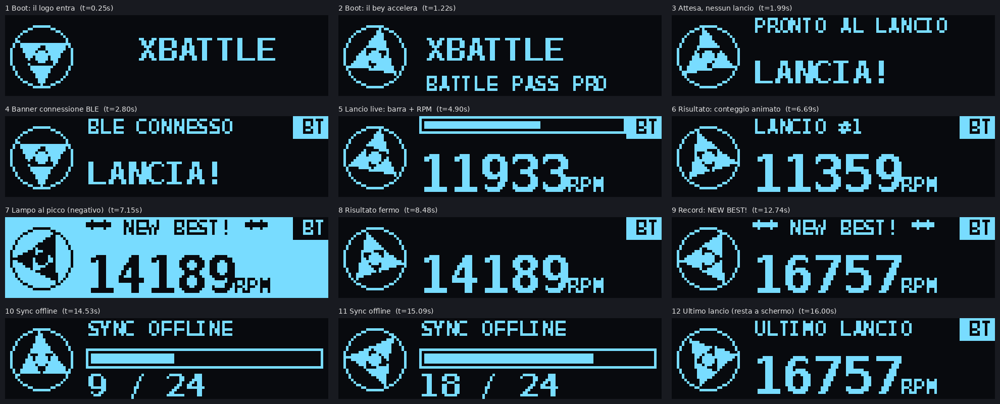

# XBattle — Beyblade X Battle Pass DIY

Dispositivo DIY che si aggancia ai lanciatori Beyblade X (String e Winder), misura la potenza di lancio con un
sensore ottico, la mostra su un piccolo OLED animato e la invia via BLE a un'app Flutter.
Riproduce l'esperienza del **BX-09 BeyBattle Pass** di Takara Tomy (vedi `docs/ORIGINALE_BX09.md`).

```
xbattle/
├── app/                        App Flutter (lib/main.dart, pubspec.yaml)
├── firmware/
│   ├── xbattle_firmware/       Sketch Arduino v2 per XIAO ESP32-C3 (OLED animato)
│   └── tools/oled_sim/         Simulatore PC dell'interfaccia OLED (anteprima senza hardware)
├── hardware/case/
│   ├── reference/              Riferimento Thingiverse (CC BY-SA) per l'attacco al lanciatore
│   └── tools/                  Calibro di tolleranza per la stampante
├── docs/                       Roadmap, analisi, hardware, misure, wiring, scheda del BX-09 originale
└── archive/                    Materiale obsoleto/deprecato (case v4, documento v3, schemi errati, firmware v1)
```

## Da dove partire
`docs/ROADMAP.md` (fasi) · `docs/ANALISI.md` (stato dei problemi) · `docs/HARDWARE.md` (lista componenti) ·
`docs/MISURE_LANCIATORI.md` (cosa misurare per il case) · `docs/wiring_diagram.md` (collegamenti)


*Anteprima simulata dell'interfaccia (font approssimati). Provata solo su PC, non ancora su hardware.*

## App (prima volta)
```bash
cd app
flutter create . --project-name bbx_battle_pass_pro --org it.xbattle   # genera android/ ios/
git checkout -- lib/main.dart pubspec.yaml                              # ripristina i file del repo
flutter pub get
flutter run
```
Aggiungi i permessi BLE in `android/app/src/main/AndroidManifest.xml` (BLUETOOTH_SCAN, BLUETOOTH_CONNECT).

## Firmware
Arduino IDE 2 → scheda **XIAO_ESP32C3**, "USB CDC On Boot: Enabled"; libreria **U8g2**; core arduino-esp32 **2.0.x**
(la 3.x ha cambiato l'API BLE). Apri `firmware/xbattle_firmware/`. Anteprima senza hardware: `firmware/tools/oled_sim/README.md`.

## Case 3D
Il vecchio case è in `archive/case_v4`. Il nuovo parte dall'attacco reale (4 sporgenze/incavi + 2 ganci a scatto):
vedi `docs/MISURE_LANCIATORI.md` e `hardware/case/reference/`.

## Licenze e crediti
- Il riferimento in `hardware/case/reference/thingiverse_6958498` è di UrAvgIdiot (ganci di Migbello), **CC BY-SA**: le parti
  del case derivate da quella geometria vanno rilasciate con la stessa licenza.
- I manuali Takara Tomy non sono nel repo (copyright): tienili in `docs/reference/` (ignorata da git).
